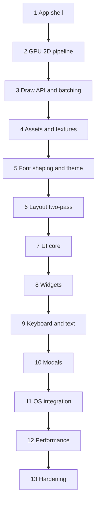

# APP UI and HUD plan — SDL3 + SDL_GPU + custom widgets

Production HUD / app UI on the hot-reload stack (`main.odin` host + `app/` DLL). Checkboxes track codebase reality: `[x]` **done**, `[~]` **partial**, `[ ]` **not done**. Sequence and non-UI work (platform game, audio, editor) live in [ROAD_MAP.md](ROAD_MAP.md).

**Out of scope here:** accessibility, packaging/installers, SVG/`draw_path`, audio, gameplay collision/camera/entities — see road map Tracks 2–5.

**Reuse as-is:** `main.odin`, `oni/scripts/build_hot_reload.sh`, hot-reload exports (`app/exports.odin`), tracking allocator in the host, `WINDOW_HIGH_PIXEL_DENSITY`, performance counter timing, `APP_TYPE` / `FRAME_MODE` in `app/globlas/global.odin`.

---

## System requirements

Oni renders through **SDL3 GPU with SPIR-V** (Vulkan on Linux). Dual-source blend is required for LCD text.

### Build / link

| Dependency | Role |
| ---------- | ---- |
| [Odin](https://odin-lang.org/) | Compiler |
| `glslc` | Compiles `oni/shaders/ui*.{vert,frag}` to SPIR-V |
| SDL3 | Window, input, SDL_GPU (pinned build under `oni/third_party/sdl3/` when used) |
| SDL3_image | Texture loading |
| FreeType | Font rasterization (gray + LCD) |
| HarfBuzz | Text shaping |
| `inotify-tools` (Linux) | Hot-reload file watch |

Build flags: `-vet -strict-style -debug`. Collections via `oni/odin_collections.sh`.

### Runtime GPU (Vulkan)

`SDL_CreateGPUDevice` with SPIR-V fails with `No supported SDL_GPU backend found!` if no Vulkan ICD enumerates a device. Install the ICD for each GPU you use (`vulkan-intel`, `vulkan-radeon`, `nvidia-utils`). Hybrid machines need the iGPU ICD even when a discrete GPU is preferred.

```bash
vulkaninfo --summary
ls /usr/share/vulkan/icd.d/
# optional:
VK_ICD_FILENAMES=/usr/share/vulkan/icd.d/intel_icd.x86_64.json ./oni/scripts/build_hot_reload.sh run
```

---

## Target architecture (synced with codebase)

### Package layout

| Path | Role | Status |
| ---- | ---- | ------ |
| `main.odin` | Hot-reload host; loads `build/hot_reload/app.so` | [x] |
| `oni/` | Engine: GPU, layout, draw, fonts, UI frame, lifecycle | [x] |
| `oni/widgets/` | Built-in widgets | [x] |
| `oni/set/` | Style helpers (`Cfg(T)`) | [x] |
| `oni/api.odin` | Public PascalCase aliases | [x] |
| `oni/templates/` | Starter host + app | [x] |
| `oni/libs/tengu` | Standalone animation library | [x] |
| `oni/libs/colors` | Color helpers | [x] |
| `app/` | Consumer demo: routes, components, theme, DLL exports | [x] |
| `assets/` | Runtime fonts / textures | [x] |
| `oni/scripts/build_hot_reload.sh` | Build, run, watch, stop | [x] |
| `oni/scripts/test_all.sh` | Package tests + leak checks | [x] |

### Engine modules

| File | Role | Status |
| ---- | ---- | ------ |
| `engine.odin` / `runtime.odin` / `state.odin` | Window/GPU lifecycle, main loop, events | [x] |
| `gpu.odin` | Device, pipelines (UI + LCD), shaders | [x] |
| `present.odin` | Frame begin/end, swapchain, present | [x] |
| `draw.odin` | Public draw API + clip / space stacks | [x] |
| `batch.odin` | Vertex/index batches, multi-atlas slots | [x] |
| `texture.odin` | Upload, sampler, production shelf atlas | [x] |
| `font_shaper.odin` / `font.odin` | Families, FreeType + HarfBuzz, glyph cache, LCD | [x] |
| `assets.odin` | Path cache, `Asset_Id` | [x] |
| `layout.odin` (+ grid / stack / chrome) | Measure + flex/grid solve | [x] |
| `ui.odin` | Two-pass UI, IDs, focus, tab order | [x] |
| `input.odin` | Mouse/keys/text session, modifiers | [x] |
| `shortcut*.odin` | Bindings, actions, text-edit integration | [x] |
| `text_edit.odin` / `text_document.odin` | Caret, selection, document model | [x] |
| `scroll.odin` | Scrollport offsets | [x] |
| `settings.odin` / `settings_kdl.odin` | User prefs (window, DPI, fonts, shortcuts) | [x] |
| `platform_os.odin` | Clipboard, open URL | [x] |
| `frame_mode.odin` | Continuous / on-demand / focused pacing | [x] |
| `gamepad.odin` | Gamepad polling (+ shortcut binds) | [x] |
| `log.odin` / `error.odin` | Logging + structured errors | [x] |
| File open/save / folder / drag-drop | Native dialogs + drop events | [ ] |

### Core types (stable)

Logical UI coordinates — design pixels, not raw framebuffer pixels.

```odin
Vec2  :: [2]f32
Rect  :: struct { x, y, w, h: f32 }
Dpi_Info :: struct {
	scale: f32,
	logical_w, logical_h: i32,
	drawable_w, drawable_h: i32,
}
Asset_Id :: distinct i32
Font_Handle / Font_Face_Handle / Font_Style / Font_Weight
UI_Id :: distinct u64
```

- [x] Logical coords + `Dpi_Info`
- [x] `Asset_Id` / texture + font handles
- [x] Theme with palette, fonts, layout defaults
- [ ] Flat `theme_light` / `theme_dark` preset procs + runtime switch demo

### Frame order (fixed)

1. Poll SDL events → update input + `Dpi_Info`
2. App tick / screens
3. `ui_begin_frame()` — reset per-frame UI transient state
4. **Pass 1 — layout:** widgets register tree nodes; solver writes `rect`
5. **Pass 2 — draw:** same widget procs; `ui_layout_rect`; emit draw + handle input
6. `ui_end_frame()` — focus / tab bookkeeping (popover via `space = .POPOVER` / `Popover_Begin`)
7. `present_frame()` — flush draw lists, present swapchain

App entry: prefer `o.Render(main_ui)` (`oni/ui.odin` / `oni/api.odin`).

### Hot reload rules

- [x] GPU objects, font families/faces, atlas live in engine state; rebound on reload
- [x] App long-lived UI state in heap `Persistent` (`app/exports.odin`); host keeps pointer across DLL swaps
- [x] `Asset_Id` + paths survive reload; GPU handles recreated via assets/texture reload
- [x] Widget code is plain procs; no long-lived UI state in package globals outside `Persistent` / engine state

---

## Section 1 — App shell

**Goal:** Window, GPU claim, resize, focus, timing, logging.

### Deliverables

- [x] Hot-reload host + `app` DLL (`build/hot_reload/app.so`)
- [x] Engine state: window, GPU, running, input, dpi, perf timing, force reload/restart
- [x] Loop: poll events + tick + clear/present (`FRAME_MODE` pacing)
- [x] Events: quit, resize, focus lost (clear keys/mouse), F5 reload, F6 restart, F11 fullscreen
- [x] Clear swapchain from theme background
- [x] `Input_State`: mouse (logical), buttons, wheel, keys, text_input buffer, modifiers
- [x] Settings.kdl for window mode / DPI / fonts / shortcuts

### Checkpoint

- [x] `./oni/scripts/build_hot_reload.sh` builds; resizable window
- [x] Minimize / restore does not crash (nil swapchain / zero drawable path)
- [x] F5 hot reload; F6 restart resets app user fields via host lifecycle
- [x] `WINDOW_HIGH_PIXEL_DENSITY` + pixel/display-scale events update `dpi`

---

## Section 2 — 2D GPU pipeline & coordinates

### Deliverables

- [x] `oni/shaders/ui.vert` / `ui.frag` (+ LCD fragment path)
- [x] SPIR-V compile in build script
- [x] `GPU_State`: pipelines, sampler, white 1×1, projection
- [x] Ortho `0..logical_w`, `0..logical_h`, Y-down logical space
- [x] Triangle list, blended alpha, dual-source LCD pipeline
- [x] `screen_to_logical` / `logical_to_screen` / `rect_contains`
- [x] Mouse in logical coords via `dpi.scale`
- [x] Artboard / screen draw spaces (`Begin_Artboard` / `Begin_Screen`)

### Checkpoint

- [x] Quads fill the window in logical space; resize updates projection
- [x] `gpu_reload()` recreates pipelines after F5
- [x] Opaque 1:1 UI text uses LCD when legal; gray fallback otherwise

---

## Section 3 — Draw API & GPU batching

### Public API

- [x] `draw_begin` / `draw_end` (+ record/flush split used by present)
- [x] `draw_push_clip` / `draw_pop_clip`
- [x] `draw_rect` with corner radii (+ border)
- [x] `draw_line`
- [x] `draw_texture` (+ fitted / atlas helpers)
- [x] Multi-atlas sampling in one batch segment (see [ATLAS.md](ATLAS.md), [DRAW.md](DRAW.md))

### Batching / present

- [x] Persistent grow-only GPU vertex/index buffers (ping-pong)
- [x] Batch key by texture / clip / pipeline / atlas slot; flush on change
- [x] Quads: 4 verts / 6 indices; scissor in framebuffer pixels
- [x] `present_frame` acquires swapchain → pass → flush → present

### Checkpoint

- [ ] Proven 10,000 `draw_rect` calls at 60 FPS (batching exists; no benchmark demo)
- [x] Nested clips scissor children
- [x] `draw_texture` with white texture and loaded images
- [x] Core draw signatures stable (extended, not replaced)

---

## Section 4 — Assets & GPU textures

### Deliverables

- [x] `assets_init` / `assets_shutdown` / reload-after-hot-reload
- [x] `assets_load_texture` / `assets_get_texture` (`Load_Texture` / `Get_Texture`)
- [x] Paths relative to exe working directory
- [x] Surface load → `SDL_CreateGPUTexture`
- [x] Path → `Asset_Id` cache; GPU re-upload on reload
- [x] Production shelf atlas (glyphs + small packs): evict, repack, grow, overflow, prefetch — [ATLAS.md](ATLAS.md)
- [ ] Ship `assets/ui/icons.png` UI icon atlas sheet
- [ ] Missing-image checker / pink-black fallback texture handle for widgets

### Checkpoint

- [ ] Load icon sheet; draw multiple sub-rects via atlas regions
- [x] Hot reload texture path
- [x] Missing file logs and returns false without crashing

---

## Section 5 — Font shaping, text & theme

### Dependencies

- [x] FreeType + HarfBuzz linked
- [x] Thin bindings: `oni/freetype.odin`, `oni/harfbuzz.odin`
- [x] LCD dual-source path — [FONT.md](../../FONT.md)

### Public font API

- [x] `Register_Font_Family` / `Font_With_Size` / `font_resolve`
- [x] Theme registers Inter; body + heading sizes
- [x] VF `wght` / `opsz`; static face weight matching; synthetic bold/italic
- [x] Glyph atlas + `font_ensure_glyphs` / layout-owned wrap + draw
- [x] Decorations: underline / line-through / overline × solid/double/dotted/dashed/wavy
- [x] Wrap modes + letter-spacing; HarfBuzz clusters; `Text_Direction` (LTR/RTL)
- [x] Prefetch APIs (`Font_Prefetch_*`)
- [ ] `theme_light()` / `theme_dark()` presets + runtime switch demo
- [ ] Optional Noto Arabic / CJK fallback families in `fixtures/fonts/`
- [ ] Demo routes proving Arabic RTL, mixed EN+AR, and CJK wrap samples

### Checkpoint

- [x] Layout-owned multi-line wrapped Latin text in clipped rects
- [x] Weight/style select VF or static faces; missing faces synthesize
- [x] Decorations for all five line styles
- [ ] Arabic / mixed / CJK demos (API ready; needs fonts + routes)
- [x] Measure/draw path shared via layout-owned text; DPI-aware raster
- [ ] Switching light/dark theme at runtime without draw-call code changes
- [x] Hot reload re-registers families and recreates GPU atlas path

---

## Section 6 — Layout (CSS-style, two-pass)

### Deliverables

- [x] Layout fields on widget config; any widget can take children
- [x] Flex child sizing (`flex`, fixed, %, hug), padding, gap, direction, justify
- [x] `min_w` / `max_w` / `min_h` / `max_h` clamps
- [x] Width/Height `.FIT` / `.GROW`
- [x] `position` (relative / absolute / fixed / sticky), `visibility`, `z_index` / order, `pointer_events`
- [x] Overflow clip + scrollports (`Scroll` / `Auto`) with overlay scroll bars
- [x] CSS-like grid (`layout_grid.odin` / `widgets/grid.odin`)
- [ ] `aspect_ratio` style field
- [x] `layout_push` / measure / `layout_solve`; pass 2 reads `ui_layout_rect`
- [x] `o.Render` runs layout then draw
- [x] Table layout (caption/head/body/foot/row/cell)

### Checkpoint

- [x] Pass 1 builds tree; pass 2 draws from stored rects
- [x] Nav + sidebar + content shell without manual `y += height`
- [x] Clamps, padding, gap; layout tests + edge tests
- [x] Text field with flex + adornments (text input widgets exist)
- [~] Nested scroll / sticky + scroll edge cases — harden as found

---

## Section 7 — UI core

### Deliverables

- [x] `UI_Pass` Layout/Draw; begin / end layout / end frame
- [x] Stable string IDs; hover / pressed / focused helpers
- [x] Focus: click sets; click-empty clears; tab moves focus
- [x] Tab order registration
- [x] Global hit stack (topmost wins); popover paint/hit slot
- [~] Modal UX widgets (dialog chrome, focus trap) on that slot — see Section 10
- [ ] `ui_want_capture_mouse` / `ui_want_capture_keyboard`
- [x] Clip push/pop during draw

### Checkpoint

- [~] Topmost-only hover/click (hit stack exists; keep a dedicated overlap demo if useful)
- [x] Click focus / clear; tab cycles focusable widgets
- [x] Wheel over scrollport consumed by scroll view

---

## Section 8 — Widget library

### Widgets

| Widget | Status |
| ------ | ------ |
| Panel-like container | [x] `Rectangle` (+ app chrome) |
| Label / paragraph / heading | [x] `Text` + `app/ui/*` helpers |
| `Text` (multi-line, wrap) | [x] |
| `Image` (fit / fill / stretch) | [x] |
| `Button` | [x] |
| `Table` (+ parts) | [x] |
| `Checkbox` | [x] |
| `Radio` / `Radio_Group` | [x] |
| `Slider` | [x] |
| `Text_Input` / `Rich_Text_Input` | [x] |
| `Select` (trigger + popup list) | [x] |
| Scroll (`overflow` + `Scroll_Bar`) | [x] |
| `Popover` | [x] |
| `Link` | [x] |
| `Calendar` / `Date_Picker` | [x] |
| `Color_Picker` | [x] |
| `Grid` | [x] |
| `Preserve` | [x] |
| `Error_Banner` | [x] |
| `Shortcuts_Table` | [x] |
| Tooltip | [ ] |
| Context menu / menu bar | [ ] |
| Dialog / modal chrome | [ ] |
| Tabs (`Tabs` / `Tabs_List` / `Tabs_Trigger` / `Tabs_Content`) | [x] |
| Progress | [ ] |

### Other

- [x] Shared style / interaction / focus / scroll helpers under `oni/widgets/widget_*.odin`
- [x] Disabled skips interaction on existing widgets
- [x] Widget gallery / docs routes under consumer `app/` (and templates)
- [x] Widgets do not call SDL/GPU directly
- [ ] Settings demo: sidebar + slider/checkbox/select/text field mutating live state (compose from shipped widgets)

### Checkpoint

- [ ] Settings demo mutates live values (volume, username, theme toggle)
- [x] Select popup draws above siblings via popover stack
- [x] Scroll view scrolls long content with scrollbar thumb
- [x] No widget proc reaches into GPU or SDL directly

---

## Section 9 — Keyboard, shortcuts & text editing

### Deliverables

- [x] Tab / Shift+Tab focus order
- [x] Shortcut table + actions (key / mouse / wheel / gamepad / sequences)
- [x] Global vs focused shortcut rules; text-edit integration
- [x] `SDL_StartTextInput` / `Stop` when a text field is focused
- [x] Caret, selection in UTF-8 / cluster-aware editing (`text_edit` / document)
- [x] Clipboard via Section 11 (`Clipboard_Get_Text` / `Set_Text`)
- [x] Arrow / Home / End / select-all / copy / paste / cut paths (shortcut + edit stack)
- [~] Undo stack for text fields (extend as needed for multi-level)
- [x] Caret blink / x from shaped advances

### Checkpoint

- [x] Tab cycles through focusable widgets
- [x] Text field: select, copy, paste (system clipboard)
- [~] Caret/selection for RTL — API direction exists; prove with Arabic demo fonts
- [x] Shortcuts do not insert into the field when consumed

---

## Section 10 — Modal & overlay layer

Stacking/hit for overlays: `space = .POPOVER`, `Popover_Begin` / `End`, Select popups. Remaining work is shared modal UX.

### Deliverables

- [~] Shared popup path (Popover / Select) — keep consolidating; no second system
- [ ] `ui_tooltip(text, anchor)` — delay; one active
- [ ] `ui_context_menu(items, pos)` — arrows + Enter; Escape closes
- [ ] Dialog / modal chrome + focus trap + click-outside (configurable)
- [ ] `ui_drag_overlay(preview)` — drag ghost
- [x] Popup/top layer drawn last; separate hit pass
- [x] Widget `on_contextmenu` hook (menu system still open)

### Checkpoint

- [ ] Dropdown/select uses only the shared popup API
- [ ] Right-click context menu on a list row
- [ ] Drag slider thumb can show a drag overlay ghost

---

## Section 11 — Native OS integration

| Feature | Status |
| ------- | ------ |
| System clipboard (SDL UTF-8) bridged to text editing | [x] |
| Open URL (`Open_URL` / allowlisted schemes) | [x] |
| File open/save dialogs | [ ] |
| Folder pick | [ ] |
| Drag and drop (`SDL_EVENT_DROP_FILE`) | [ ] |
| Persist window size/position/maximized | [~] mode via settings; geometry restore open |
| Multi-monitor DPI | [x] dpi events; [ ] dialog re-center when dialogs exist |

### Checkpoint

- [ ] Open file dialog loads path into a text field
- [ ] Drag image onto window loads preview in `Image`
- [x] Copy/paste between app and external text editor
- [ ] Restart app restores window geometry

---

## Section 12 — Performance

### Deliverables

- [x] Frame modes: continuous / on-demand / focused dirty wake — [FRAME_MODES.md](FRAME_MODES.md)
- [x] On-demand present skip when wake-only and not oneshot dirty (`Request_Frame`); partial dirty-rect region updates deferred
- [ ] `ui_list_virtualized(count, row_h, body)`
- [ ] Virtualization used by select / asset lists
- [ ] F3 (or settings) debug overlay: FPS, draw_call_count, batch_flush_count, atlas stats
- [ ] Log frame spikes > 33 ms
- [~] Atlas / font / batch production paths — see [ATLAS.md](ATLAS.md), AGENTS.md Performance

### Checkpoint

- [ ] 10k-row virtual list scrolls at 60 FPS
- [x] Dirty / on-demand mode keeps idle CPU low (wait + wake-only present skip; caret uses `Request_Frame`)
- [ ] Debug overlay shows batch / atlas stats without stuttering

---

## Section 13 — Production hardening

### Deliverables

- [x] `log_error` / `log_warn` / debug helpers with file/line
- [x] Structured errors / on-screen error banner
- [ ] Non-fatal toast panel (auto-dismiss) via modal layer
- [ ] Fatal GPU device loss: message box + graceful quit
- [ ] RenderDoc notes; pipeline `debug_name` where useful
- [ ] Checker `Texture_Handle` for missing images; widgets still layout
- [ ] Document browser demo: menu bar, virtualized file list, main text area, status bar
- [x] Host tracking allocator + `test_all.sh` leak failure
- [x] Production atlas ship criteria (groups A–I) — [ATLAS.md](ATLAS.md)

### Checkpoint

- [ ] Deliberately missing texture shows fallback, logs once, no crash
- [ ] GPU pipeline creation failure shows error banner and exits cleanly
- [ ] Document browser survives F5 with document text preserved in `Persistent`
- [x] Tracking allocator path exists for leak reporting on quit / tests

---

## Build & assets checklist

### `oni/scripts/build_hot_reload.sh`

- [x] Compile UI (+ LCD) shaders to SPIR-V
- [x] Link FreeType + HarfBuzz
- [x] Build host + `app` shared library; watch `oni/` and `app/`
- [ ] Optional: copy `assets/` next to `build/hot_reload/` output on build

### `assets/` layout

```
assets/
  fonts/
    Inter-VariableFont_opsz,wght.ttf          [x]
    Inter-Italic-VariableFont_opsz,wght.ttf   [x]
    PixelOperator8.ttf                        [x]
    PixelOperator8-Bold.ttf                   [x]
    NotoSansArabic-Regular.ttf                [ ] optional
    NotoSansJP-Regular.otf                    [ ] optional
  ui/
    icons.png                                 [ ]
  textures/
    fallback.png                              [ ]
```

### Dependencies

- [x] Vulkan SDK (`glslc`) / `shaderc`
- [x] SDL3 with GPU (+ dual-source for LCD)
- [x] FreeType
- [x] HarfBuzz (with FreeType support)

---

## Section dependency graph



**Progress snapshot:** Sections **1–9** are largely shipped (form widgets, shortcuts, text edit, scroll, grid, production atlas, LCD text). Open work concentrates in **10** (tooltip/menu/dialog), remaining **11** (file dialogs / DnD / geometry persist), **12** (virtualization / debug overlay), and **13** (toasts, fallbacks, document-browser demo). Platform game, audio, and editor are **not** in this file — see [ROAD_MAP.md](ROAD_MAP.md).

---

## What this plan deliberately excludes

| Topic | Where it lives |
| ----- | -------------- |
| Accessibility | Road map Track 5 |
| Packaging / installers / code signing | Road map Track 5 |
| SVG / vector paths | Road map Track 5 |
| Audio (SDL3_mixer) | Road map Track 3 |
| Platform game (collision, camera, entities) | Road map Track 2 |
| Tiny level editor | Road map Track 4 |
| Dear ImGui / other GUI libraries | Never |
