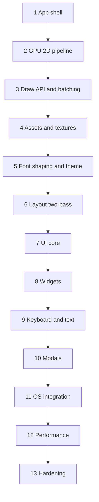

# APP UI and HUD plan — SDL3 + SDL_GPU + custom widgets

Production HUD / app UI on the hot-reload stack (`main.odin` host + `app/` DLL). Checkboxes track codebase reality: `[x]` **done**, `[~]` **partial**, `[ ]` **not done**. Sequence and non-UI work (platform game, audio, editor) live in [ROAD_MAP.md](ROAD_MAP.md).

**Related scope:** accessibility, installers/signing, audio and gameplay collision/camera/entities are tracked in road map Tracks 2–5. Static production builds and tarball packaging are implemented. Native vector/SVG drawing is implemented with a separate open performance acceptance gate; see [VECTOR.md](VECTOR.md) and [SVG-SUPPORTED-PROFILE.md](SVG-SUPPORTED-PROFILE.md).

**Reuse as-is:** `main.odin`, `oni/scripts/build_hot_reload.sh`, hot-reload exports (`app/exports.odin`), tracking allocator in the host, `WINDOW_HIGH_PIXEL_DENSITY`, performance counter timing, `APP_TYPE` / `FRAME_MODE` in `app/globlas/global.odin`.

---

## System requirements

Oni renders through **SDL3 GPU with SPIR-V** (Vulkan on Linux). Dual-source blend is required for LCD text.

### Build / link

| Dependency | Role |
| ---------- | ---- |
| [Odin](https://odin-lang.org/) | Compiler |
| `glslc` | Compiles `oni/shaders/` UI, LCD, vector and probe shaders to SPIR-V |
| SDL3 | Window, input, SDL_GPU (pinned build under `oni/third_party/sdl3/` when used) |
| SDL3_image | Texture loading |
| FreeType | Font rasterization (gray + LCD) |
| HarfBuzz | Text shaping |
| `inotify-tools` (Linux) | Hot-reload file watch |

Development flags: `-vet -strict-style -debug -o:speed`. Speed optimization keeps the per-frame UI rebuild responsive; `-debug` alone defaults to unoptimized code. Debug information, assertions, bounds checks and SDL GPU diagnostics remain enabled, although optimized locals and stepping may differ in the debugger and compilation takes longer. Production flags: `-vet -strict-style -o:speed -disable-assert`. Collections and optional local SDL linker flags come from `oni/odin_collections.sh`.

Run these from the consumer root; scripts resolve that root as the parent of `oni/` unless `ONI_PROJECT_ROOT` is set. Development uses `./oni/scripts/build_hot_reload.sh run` (`build`, `restart` and `stop` are also available). Production uses `./oni/scripts/build_production.sh build`, then `run`, `smoke` or `package`; output and staged assets live under `build/production/`. The release host is copied from `templates/release/main.odin` when missing. On Linux the package bundles non-GPU shared libraries under `lib/` with `$ORIGIN/lib` rpath; Vulkan ICDs remain OS-provided. `ONI_APP_NAME` overrides the binary name and `ONI_SMOKE_FRAMES` controls smoke duration (default 3).

### Runtime GPU (Vulkan)

`SDL_CreateGPUDevice` with SPIR-V fails with `No supported SDL_GPU backend found!` if no Vulkan ICD enumerates a device. Install the ICD for each GPU you use (`vulkan-intel`, `vulkan-radeon`, `nvidia-utils`). Hybrid machines need the iGPU ICD even when a discrete GPU is preferred.

```bash
vulkaninfo --summary
ls /usr/share/vulkan/icd.d/
# optional:
VK_ICD_FILENAMES=/usr/share/vulkan/icd.d/intel_icd.x86_64.json ./oni/scripts/build_hot_reload.sh run
```

---

## Target architecture (synced with codebase)

### Package layout

| Path | Role | Status |
| ---- | ---- | ------ |
| `main.odin` | Hot-reload host; loads `build/hot_reload/app.so` | [x] |
| `oni/` | Engine: GPU, layout, draw, fonts, UI frame, lifecycle | [x] |
| `oni/widgets/` | Built-in widgets | [x] |
| `oni/set/` | Style helpers (`Cfg(T)`) | [x] |
| `oni/api.odin` | Public PascalCase aliases | [x] |
| `oni/templates/` | Starter host + app | [x] |
| `oni/libs/tengu` | Standalone animation library | [x] |
| `oni/libs/colors` | Color helpers | [x] |
| `oni/vector/` | Standalone CPU path, tessellation and SVG package | [x] |
| `release/main.odin` | Static production host | [x] |
| `oni/scripts/build_production.sh` | Optimized build, staging, smoke and tarball packaging | [x] |
| `app/` | Consumer demo: routes, components, theme, DLL exports | [x] |
| `assets/` | Runtime fonts / textures | [x] |
| `oni/scripts/build_hot_reload.sh` | Build, run, watch, stop | [x] |
| `oni/scripts/test_all.sh` | Package tests + leak checks | [x] |

### Engine modules

| File | Role | Status |
| ---- | ---- | ------ |
| `engine.odin` / `runtime.odin` / `state.odin` | Window/GPU lifecycle, main loop, events | [x] |
| `gpu.odin` | Device, pipelines (UI + LCD), shaders | [x] |
| `present.odin` | Frame begin/end, swapchain, present | [x] |
| `draw.odin` | Public draw API + clip / space stacks | [x] |
| `batch.odin` | Vertex/index batches, multi-atlas slots | [x] |
| `texture.odin` | Upload, sampler, production shelf atlas | [x] |
| `font_shaper.odin` / `font.odin` | Families, FreeType + HarfBuzz, glyph cache, LCD | [x] |
| `assets.odin` / `assets_io.odin` | Reference-counted async texture requests, decode workers, owner-thread drain | [x] |
| `vector*.odin` / `layout_vector.odin` | Retained paths, scenes, SVG instances, GPU composition and widget geometry | [x] |
| `layout.odin` (+ grid / stack / chrome) | Measure + flex/grid solve | [x] |
| `ui.odin` | Two-pass UI, IDs, focus, tab order | [x] |
| `input.odin` | Mouse/keys/text session, modifiers | [x] |
| `shortcut*.odin` | Bindings, actions, text-edit integration | [x] |
| `text_edit.odin` / `text_document.odin` | Caret, selection, document model | [x] |
| `scroll.odin` | Scrollport offsets | [x] |
| `settings.odin` / `settings_kdl.odin` | User prefs (window, DPI, fonts, shortcuts) | [x] |
| `platform_os.odin` | Clipboard, open URL | [x] |
| `frame_mode.odin` | Continuous / on-demand / focused pacing | [x] |
| `gamepad.odin` | Gamepad polling (+ shortcut binds) | [x] |
| `log.odin` / `error.odin` | Logging + structured errors | [x] |
| File open/save / folder | Native modal pickers; owned results | [x] |
| File drag-drop | Native drop events | [ ] |

### Core types (stable)

Logical UI coordinates — design pixels, not raw framebuffer pixels.

```odin
Vec2  :: [2]f32
Rect  :: struct { x, y, w, h: f32 }
Dpi_Info :: struct {
	scale: f32,
	logical_w, logical_h: i32,
	drawable_w, drawable_h: i32,
}
Asset_Id :: distinct i32
Font_Handle / Font_Face_Handle / Font_Style / Font_Weight
UI_Id :: distinct u64
```

- [x] Logical coords + `Dpi_Info`
- [x] `Asset_Id` / texture + font handles
- [x] Theme with palette, fonts, layout defaults
- [ ] Flat `theme_light` / `theme_dark` preset procs + runtime switch demo

### Frame order (fixed)

Matches `run_frame` in `oni/runtime.odin` (pacing may skip the body or present):

1. Pacing wait → `input_begin_frame` → poll SDL events (+ `settings_poll`) → update input / DPI; return early if rendering/work is unavailable. Drain async asset completions before UI begin.
2. `ui_begin_frame()` — Layout pass; reset per-frame UI / layout
3. App `tick(dt)` (and first-frame `init` once)
4. `present_frame(draw)` — CPU record, then GPU upload/present:
   - App draw callback calls `o.Render(main_ui)` (`oni/ui.odin` / `oni/api.odin`)
   - **Pass 1 — layout:** widgets register tree; space end solves rects; optional error banner UI
   - `ui_end_layout_pass()` — layer/anchor solve, stack order, pointer hit, focus/tab, shortcuts → Draw
   - **Pass 2 — draw:** same widget procs; `ui_layout_rect`; emit draw + input handlers
   - `ui_end_frame()` — prune widgets not touched this builder (not focus/tab)
5. Host `end_frame()` — `ui_end_frame` again (usually no-op after `Render`)

Popover chrome uses `space = .POPOVER` / `Popover_Begin`; Dialog and framework chrome use `.OVERLAY`. Both are layers in the same frame.

### Hot reload rules

- [x] GPU objects, font families/faces, atlas live in engine state; rebound on reload
- [x] App long-lived UI state in heap `Persistent` (`app/exports.odin`); host keeps pointer across DLL swaps
- [x] Texture ids/paths survive reload; generation/token checks reject stale async completions, and retained surfaces re-upload before returning to Ready
- [x] Widget code is plain procs; no long-lived UI state in package globals outside `Persistent` / engine state

---

## Section 1 — App shell

**Goal:** Window, GPU claim, resize, focus, timing, logging.

### Deliverables

- [x] Hot-reload host + `app` DLL (`build/hot_reload/app.so`)
- [x] Engine state: window, GPU, running, input, dpi, perf timing, force reload/restart
- [x] Loop: poll events + tick + clear/present (`FRAME_MODE` pacing)
- [x] Events: quit, resize, focus lost (clear keys/mouse), F5 reload, F6 restart, F11 fullscreen
- [x] Clear swapchain from theme background
- [x] `Input_State`: mouse (logical), buttons, wheel, keys, text_input buffer, modifiers
- [x] Settings.kdl for window mode / DPI / fonts / shortcuts

### Checkpoint

- [x] `./oni/scripts/build_hot_reload.sh` builds; resizable window
- [x] Minimize / restore does not crash (nil swapchain / zero drawable path)
- [x] F5 hot reload; F6 restart resets app user fields via host lifecycle
- [x] `WINDOW_HIGH_PIXEL_DENSITY` + pixel/display-scale events update `dpi`

---

## Section 2 — 2D GPU pipeline & coordinates

### Deliverables

- [x] `oni/shaders/ui.vert` / `ui.frag` (+ LCD fragment path)
- [x] SPIR-V compile in build script
- [x] `GPU_State`: pipelines, sampler, white 1×1, projection
- [x] Ortho `0..logical_w`, `0..logical_h`, Y-down logical space
- [x] Triangle list, blended alpha, dual-source LCD pipeline
- [x] `screen_to_logical` / `logical_to_screen` / `rect_contains`
- [x] Mouse in logical coords via `dpi.scale`
- [x] Artboard / screen draw spaces (`Begin_Artboard` / `Begin_Screen`)

### Checkpoint

- [x] Quads fill the window in logical space; resize updates projection
- [x] `gpu_reload()` recreates pipelines after F5
- [x] Opaque 1:1 UI text uses LCD when legal; gray fallback otherwise

---

## Section 3 — Draw API & GPU batching

### Public API

- [x] `draw_begin` / `draw_end` (+ record/flush split used by present)
- [x] `draw_push_clip` / `draw_pop_clip`
- [x] `draw_rect` with corner radii (+ border)
- [x] `draw_line`
- [x] `draw_texture` (+ fitted / atlas helpers)
- [x] Multi-atlas sampling in one batch segment (see [ATLAS.md](ATLAS.md), [DRAW.md](DRAW.md))

### Batching / present

- [x] Persistent grow-only GPU vertex/index buffers (ping-pong)
- [x] Batch key by texture / clip / pipeline / atlas slot; flush on change
- [x] Quads: 4 verts / 6 indices; scissor in framebuffer pixels
- [x] `present_frame` acquires swapchain → pass → flush → present

### Checkpoint

- [ ] Proven 10,000 `draw_rect` calls at 60 FPS (batching exists; no benchmark demo)
- [x] Nested clips scissor children
- [x] `draw_texture` with white texture and loaded images
- [x] Core draw signatures stable (extended, not replaced)

---

## Section 4 — Assets & GPU textures

### Deliverables

- [x] `assets_init` / `assets_shutdown` / reload-after-hot-reload
- [x] `assets_load_texture` / `assets_get_texture` (`Load_Texture` / `Get_Texture`)
- [x] Paths relative to exe working directory
- [x] Worker disk/decode → owner drain → deferred GPU upload; Ready after submission
- [x] Path → `Asset_Id` cache; GPU re-upload on reload
- [x] Production shelf atlas (glyphs + small packs): evict, repack, grow, overflow, prefetch — [ATLAS.md](ATLAS.md)
- [ ] Ship `assets/ui/icons.png` UI icon atlas sheet
- [ ] Missing-image checker / pink-black fallback texture handle for widgets

### Async texture contract

`Load_Texture(path)` returns a handle and an acceptance bool. Accepted requests can be Pending or Failed; the bool never promises Ready pixels. `Texture_Status` is authoritative, and `Get_Texture(handle.id)` supplies current dimensions after Ready. Duplicate normalized paths acquire another reference; request once when app content changes, and balance each accepted call with `Unload_Texture`. Failed records remain Failed until `Retry_Texture`. `Texture_Error` returns independently owned diagnostic text; release it with `Texture_Error_Free`. Pending/Failed images have zero intrinsic dimensions, so give placeholders explicit sizes if needed.

Workers perform disk/decode only. The owner drains completions in `Run_Frame` / `Present_Frame` and publishes Ready after upload submission. Admission bounds encoded size at 32 MiB, decoded image bytes at 64 MiB, image edge at 8,192 and in-flight surfaces at 128 MiB. Per-frame drains admit up to 16 completions and about 16 MiB of uploads. Unload, retry and device recreation use generations/tokens to reject stale completions; reload joins workers before replacing GPU state.

### Checkpoint

- [ ] Load icon sheet; draw multiple sub-rects via atlas regions
- [x] Hot reload texture path
- [x] Accepted missing-file requests become Failed with a diagnostic; immediate rejection returns false

---

## Section 5 — Font shaping, text & theme

### Dependencies

- [x] FreeType + HarfBuzz linked
- [x] Thin bindings: `oni/freetype.odin`, `oni/harfbuzz.odin`
- [x] LCD dual-source path — [DRAW.md](DRAW.md#text-draw-onifontodin)

### Public font API

- [x] `Register_Font_Family` / `Font_With_Size` / `font_resolve`
- [x] Theme registers Inter; body + heading sizes
- [x] VF `wght` / `opsz`; static face weight matching; synthetic bold/italic
- [x] Glyph atlas + `font_ensure_glyphs` / layout-owned wrap + draw
- [x] Persistent shaped-line cache; layout borrows cached lines, invalidated on DPI/font reload
- [x] Decorations: underline / line-through / overline × solid/double/dotted/dashed/wavy
- [x] Wrap modes + letter-spacing; HarfBuzz clusters; `Text_Direction` (LTR/RTL)
- [x] Prefetch APIs (`Font_Prefetch_*`)
- [ ] `theme_light()` / `theme_dark()` presets + runtime switch demo
- [ ] Optional Noto Arabic / CJK fallback families in `fixtures/fonts/`
- [ ] Demo routes proving Arabic RTL, mixed EN+AR, and CJK wrap samples

### Checkpoint

- [x] Layout-owned multi-line wrapped Latin text in clipped rects
- [x] Weight/style select VF or static faces; missing faces synthesize
- [x] Decorations for all five line styles
- [ ] Arabic / mixed / CJK demos (API ready; needs fonts + routes)
- [x] Measure/draw path shared via layout-owned text; DPI-aware raster
- [ ] Switching light/dark theme at runtime without draw-call code changes
- [x] Hot reload re-registers families and recreates GPU atlas path

---

## Section 6 — Layout (CSS-style, two-pass)

### Deliverables

- [x] Layout fields on widget config; any widget can take children
- [x] Flex child sizing (`flex`, fixed, %, hug), padding, gap, direction, justify
- [x] `min_w` / `max_w` / `min_h` / `max_h` clamps
- [x] Width/Height `.FIT` / `.GROW`
- [x] `position` (relative / absolute / fixed / sticky), `visibility`, `z_index` / order, `pointer_events`
- [x] Overflow clip + scrollports (`Scroll` / `Auto`) with overlay scroll bars
- [x] CSS-like grid (`layout_grid.odin` / `widgets/grid.odin`)
- [ ] `aspect_ratio` style field
- [x] `layout_push` / measure / `layout_solve`; pass 2 reads `ui_layout_rect`
- [x] `o.Render` runs layout then draw
- [x] Table layout (caption/head/body/foot/row/cell)

### Checkpoint

- [x] Pass 1 builds tree; pass 2 draws from stored rects
- [x] Nav + sidebar + content shell without manual `y += height`
- [x] Clamps, padding, gap; layout tests + edge tests
- [x] Text field with flex + adornments (text input widgets exist)
- [~] Nested scroll / sticky + scroll edge cases — harden as found

---

## Section 7 — UI core

### Deliverables

- [x] `UI_Pass` Layout/Draw; begin / end layout / end frame
- [x] Stable string IDs; hover / pressed / focused helpers
- [x] Focus: click sets; click-empty clears; tab moves focus
- [x] Tab order registration
- [x] Global hit stack (topmost wins); popover paint/hit slot
- [x] Dialog / Context_Menu chrome and dismiss paths — see Section 10
- [ ] Hard modal focus trap
- [ ] `ui_want_capture_mouse` / `ui_want_capture_keyboard`
- [x] Clip push/pop during draw

### Checkpoint

- [~] Topmost-only hover/click (hit stack exists; keep a dedicated overlap demo if useful)
- [x] Click focus / clear; tab cycles focusable widgets
- [x] Wheel over scrollport consumed by scroll view

---

## Section 8 — Widget library

### Widgets

| Widget | Status |
| ------ | ------ |
| Panel-like container | [x] `Rectangle` (+ app chrome) |
| Label / paragraph / heading | [x] `Text` + `app/ui/*` helpers |
| `Text` (multi-line, wrap) | [x] |
| `Image` (fit / fill / stretch) | [x] |
| `Button` | [x] |
| `Table` (+ parts) | [x] |
| `Checkbox` | [x] |
| `Radio` / `Radio_Group` | [x] |
| `Slider` | [x] |
| `Text_Input` / `Rich_Text_Input` | [x] |
| `Select` (trigger + popup list) | [x] |
| Scroll (`overflow` + `Scroll_Bar`) | [x] |
| `Popover` | [x] |
| `Link` | [x] |
| `Calendar` / `Date_Picker` | [x] |
| `Color_Picker` | [x] |
| `Grid` | [x] |
| `Preserve` | [x] |
| `Error_Banner` | [x] |
| `Shortcuts_Table` | [x] |
| Tooltip | [ ] |
| Context_Menu (+ Trigger/Content/Item/Separator) | [x] |
| Menu bar | [ ] |
| Dialog (+ Trigger/Scrim/Content/Actions) | [x] chrome + dismiss; focus trap open |
| Tabs (`Tabs` / `Tabs_List` / `Tabs_Trigger` / `Tabs_Content`) | [x] |
| Progress (+ Label/Value/Track/Indicator) | [x] |
| Collapsible (+ Trigger/Content) | [x] |
| Accordion (+ Item/Trigger/Content) | [x] |
| Vector / Svg | [x] APIs and controlled widgets; release performance gate open |

### Other

- [x] Shared style / interaction / focus / scroll helpers under `oni/widgets/widget_*.odin`
- [x] Disabled skips interaction on existing widgets
- [x] Widget gallery / docs routes under consumer `app/` (and templates)
- [x] Widgets do not call SDL/GPU directly
- [ ] Settings demo: sidebar + slider/checkbox/select/text field mutating live state (compose from shipped widgets)

### Checkpoint

- [ ] Settings demo mutates live values (volume, username, theme toggle)
- [x] Select popup draws above siblings via popover stack
- [x] Scroll view scrolls long content with scrollbar thumb
- [x] No widget proc reaches into GPU or SDL directly

---

## Section 9 — Keyboard, shortcuts & text editing

### Deliverables

- [x] Tab / Shift+Tab focus order
- [x] Shortcut table + actions (key / mouse / wheel / gamepad / sequences)
- [x] Global vs focused shortcut rules; text-edit integration
- [x] `SDL_StartTextInput` / `Stop` when a text field is focused
- [x] Caret, selection in UTF-8 / cluster-aware editing (`text_edit` / document)
- [x] Clipboard via Section 11 (`Clipboard_Get_Text` / `Set_Text`)
- [x] Arrow / Home / End / select-all / copy / paste / cut paths (shortcut + edit stack)
- [x] Multi-level undo/redo for text fields (64-entry bounded stacks; edits coalesce within a frame)
- [x] Caret blink / x from shaped advances

### Checkpoint

- [x] Tab cycles through focusable widgets
- [x] Text field: select, copy, paste (system clipboard)
- [~] Caret/selection for RTL — API direction exists; prove with Arabic demo fonts
- [x] Shortcuts do not insert into the field when consumed

---

## Section 10 — Modal & overlay layer

Stacking/hit uses `.POPOVER` for Popover, Select and Context_Menu, and `.OVERLAY` for Dialog/framework chrome. `Popover_Begin` / `Popover_End` and `Begin_Overlay` / `End_Overlay` scope the same frame; neither starts a separate render loop. Hard modal focus trapping, tooltip delay and menu-bar navigation remain open.

Popup control uses `Popover_Handle` through `Popover_Is_Open(handle)`, `Popover_Set_Open(handle, open)` and `Popover_Toggle(handle)`. Popover, Select, Date_Picker and Context_Menu child callbacks receive their own handle in `frame_state.popup`; inline Select listboxes receive an empty handle. Handles belong to the current callback/pass and must not be retained across frames. Expired handles are inert, including after stack-slot reuse and shutdown. Open values remain app-owned via `config.open` and `on_open_change`; repeated requests for the current value do not notify again.

All four popup widgets use `Popover_Claim_Pointer(handle)` and `Popover_Process_Dismissal(handle)` internally. Nested panel hits also claim enclosing roots, Escape closes the innermost enabled popup and is consumed once, and disabled roots do not consume it. Outside left presses dismiss all popup types; Context_Menu also dismisses on outside right presses. Select and Date_Picker retain domain keyboard navigation but delegate dismissal and open transitions to the shared control path. Placement still uses the existing anchored Popover panel or pointer-anchored Context_Menu panel in `.POPOVER` space.

The implicit `Popover_Is_Open()` / `Popover_Set_Open(open)`, `Context_Menu_Is_Open()` / `Context_Menu_Set_Open(open)`, `Select_Is_Open()`, and `Date_Picker_Is_Open()` / `Date_Picker_Set_Open(open)` APIs have been removed. Inline listbox content activity is available as `Select_State.open`. Use the scoped handle from the owning child callback with the shared API.

### Deliverables

- [x] Shared popup control (Popover / Select / Date_Picker / Context_Menu) — scoped handles, one dismissal path; no second system
- [ ] `ui_tooltip(text, anchor)` — delay; one active
- [x] `Context_Menu` compound parts; Escape/outside dismissal and tabbable items
- [ ] Menu-bar / complete arrow-key menu navigation
- [x] Dialog chrome + Escape / outside dismissal
- [ ] Hard focus trap while Dialog is open
- [ ] `ui_drag_overlay(preview)` — drag ghost
- [x] Popup/top layer drawn last; separate hit pass
- [x] Widget `on_contextmenu` hook and Context_Menu composition

### Checkpoint

- [x] Dropdown/select uses only the shared popup API
- [ ] Right-click context menu on a list row
- [ ] Drag slider thumb can show a drag overlay ghost

---

## Section 11 — Native OS integration

| Feature | Status |
| ------- | ------ |
| System clipboard (SDL UTF-8) bridged to text editing | [x] |
| Open URL (`Open_URL` / allowlisted schemes) | [x] |
| File open/save dialogs | [x] `Open_File_Dialog` / `Save_File_Dialog` |
| Folder pick | [x] `Pick_Folder`, including multi-selection |
| Drag and drop (`SDL_EVENT_DROP_FILE`) | [ ] |
| Persist window size/position/maximized | [~] mode via settings; geometry restore open |
| Multi-monitor DPI | [x] dpi events; [ ] dialog re-center when dialogs exist |

Native dialogs use one modal, main-thread API with explicit result ownership; see [NATIVE_DIALOGS.md](NATIVE_DIALOGS.md) for options, error handling, cleanup and controlled text-field integration. Selection does not perform file I/O.

### Checkpoint

- [ ] Open file dialog loads path into a text field
- [ ] Drag image onto window loads preview in `Image`
- [x] Copy/paste between app and external text editor
- [ ] Restart app restores window geometry

---

## Section 12 — Performance

### Deliverables

- [x] Frame modes: continuous / on-demand / focused dirty wake — [FRAME_MODES.md](FRAME_MODES.md)
- [x] On-demand present skip when wake-only and not oneshot dirty (`Request_Frame`); partial dirty-rect region updates deferred
- [ ] `ui_list_virtualized(count, row_h, body)`
- [ ] Virtualization used by select / asset lists
- [ ] F3 (or settings) debug overlay: FPS, draw_call_count, batch_flush_count, atlas stats
- [ ] Log frame spikes > 33 ms
- [x] Glyph atlas recovery, pooled raster workers and multi-texture batching — see [ATLAS.md](ATLAS.md)
- [x] Shaped-line caching, frame-arena layout scratch and async texture decode/deferred uploads
- [~] Native vector/SVG dense-scene performance — correctness features exist; release benchmark acceptance remains open ([VECTOR.md](VECTOR.md))

### Checkpoint

- [ ] 10k-row virtual list scrolls at 60 FPS
- [x] Dirty / on-demand mode keeps idle CPU low (wait + wake-only present skip; caret uses `Request_Frame`)
- [ ] Debug overlay shows batch / atlas stats without stuttering

---

## Section 13 — Production hardening

### Deliverables

- [x] `log_error` / `log_warn` / debug helpers with file/line
- [x] Structured errors / on-screen error banner
- [ ] Non-fatal toast panel (auto-dismiss) via modal layer
- [ ] Fatal GPU device loss: message box + graceful quit
- [ ] RenderDoc notes; pipeline `debug_name` where useful
- [ ] Checker `Texture_Handle` for missing images; widgets still layout
- [ ] Document browser demo: menu bar, virtualized file list, main text area, status bar
- [x] Host tracking allocator + `test_all.sh` leak failure
- [x] Production atlas ship criteria (groups A–I) — [ATLAS.md](ATLAS.md)

### Checkpoint

- [ ] Deliberately missing texture shows fallback, logs once, no crash
- [ ] GPU pipeline creation failure shows error banner and exits cleanly
- [ ] Document browser survives F5 with document text preserved in `Persistent`
- [x] Tracking allocator path exists for leak reporting on quit / tests

---

## Build & assets checklist

### `oni/scripts/build_hot_reload.sh`

- [x] Compile UI, LCD, vector and probe shaders to SPIR-V
- [x] Link FreeType + HarfBuzz
- [x] Build host + `app` shared library; watch `oni/` and `app/`
- [x] Development runs from consumer root and reads its `assets/`; production stages assets beside the release binary

### Consumer `assets/` example

The framework embeds default Inter faces from `assets/fonts/` when no settings faces are configured. The following consumer layout is illustrative; optional PixelOperator/Noto fonts and icon sheets must be supplied by the consumer. Tests use `fixtures/fonts/`.

```
assets/
  fonts/
    Inter-VariableFont_opsz,wght.ttf          [x]
    Inter-Italic-VariableFont_opsz,wght.ttf   [x]
    PixelOperator8.ttf                        optional
    PixelOperator8-Bold.ttf                   optional
    NotoSansArabic-Regular.ttf                [ ] optional
    NotoSansJP-Regular.otf                    [ ] optional
  ui/
    icons.png                                 [ ]
  textures/
    fallback.png                              [ ]
```

### Dependencies

- [x] Vulkan SDK (`glslc`) / `shaderc`
- [x] SDL3 with GPU (+ dual-source for LCD)
- [x] FreeType
- [x] HarfBuzz (with FreeType support)

---

## Section dependency graph



**Progress snapshot:** Sections **1–9** are largely shipped (form widgets, shortcuts, text edit, scroll, grid, production atlas, cached shaping, LCD text, async assets and native vectors). Dialog, Context_Menu, Progress, Collapsible and Accordion are implemented. Open work concentrates in **10** (tooltip/menu bar/focus trap), remaining **11** (DnD / geometry persist), **12** (virtualization / debug overlay / vector release performance), and **13** (toasts, fallbacks, document-browser demo). Platform game, audio, and editor are **not** in this file — see [ROAD_MAP.md](ROAD_MAP.md).

---

## What this plan deliberately excludes

| Topic | Where it lives |
| ----- | -------------- |
| Accessibility | Road map Track 5 |
| Installers / code signing (static build + tarball already implemented) | Road map Track 5 |
| Native SVG / vector contract and open release gate | [VECTOR.md](VECTOR.md) |
| Audio (SDL3_mixer) | Road map Track 3 |
| Platform game (collision, camera, entities) | Road map Track 2 |
| Tiny level editor | Road map Track 4 |
| Dear ImGui / other GUI libraries | Never |
