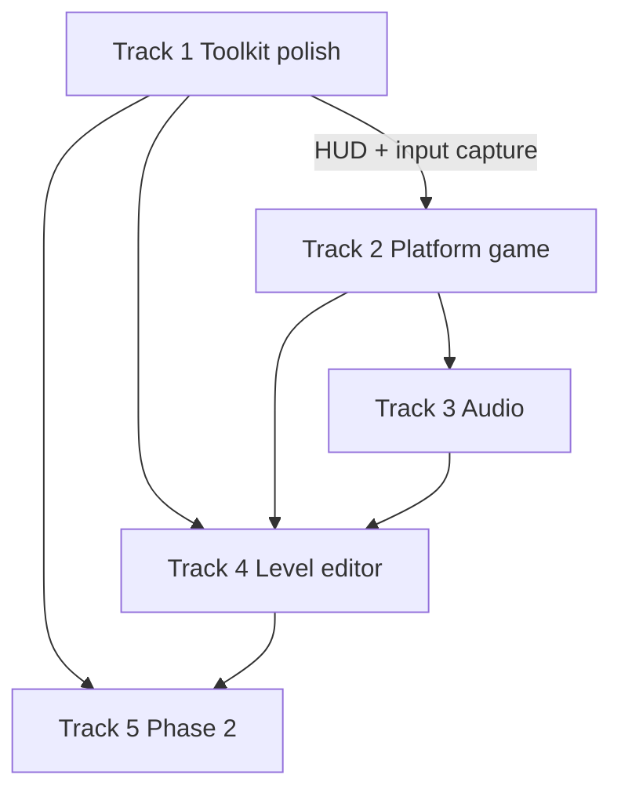

# Oni road map

Product and engineering order for Oni: **desktop UI toolkit first**, then a **playable platform game** on the same hot-reload stack, then audio / editor polish. Detail checklists live in sibling docs; this file is the sequence and exit criteria.

| Doc | Owns |
| --- | --- |
| [ARCHITECTURE.md](ARCHITECTURE.md) | Immediate-mode model, props/callbacks, state ownership (model of record) |
| [APP.md](APP.md) | UI / HUD feature checklist vs codebase |
| [ATLAS.md](ATLAS.md) | Production glyph atlas (shipped; policy + groups A–I) |
| [FONT.md](../../FONT.md) | LCD / dual-source text sharpness (shipped; lives at repo-parent `FONT.md`) |
| [DRAW.md](DRAW.md) | Draw / batch / present model |
| [Layout.md](Layout.md) | Layout solve rules (flex + CSS-like grid) |
| [FRAME_MODES.md](FRAME_MODES.md) | Frame pacing (`FRAME_MODE`) |
| [attributes.md](attributes.md) | CSS ↔ style field map |

**Status legend:** `[x]` done · `[~]` partial · `[ ]` open

---

## North star

One Odin stack (SDL3 + SDL_GPU + custom widgets, no Dear ImGui) that ships:

1. Production **app / tool UI** (forms, text, tables, overlays, settings)
2. A **side-scrolling platform game** that uses the same host, draw API, and hot reload
3. Optional **audio** and a **tiny level editor** built from Oni widgets

Consumer layout stays: `main.odin` host + `app/` DLL + `oni/` framework. Gameplay lives in the consumer app (or a dedicated game package), not inside the framework core.

---

## Where we are (baseline)

Shipped and in daily use:

- [x] Hot-reload host + `app.so`, F5/F6, tracking allocator
- [x] SDL_GPU 2D pipeline, batching, clips, artboard / screen spaces
- [x] Assets + textures; production dynamic atlas (evict / repack / grow / overflow / multi-texture) — see [ATLAS.md](ATLAS.md)
- [x] FreeType + HarfBuzz, LCD dual-source text — see [FONT.md](../../FONT.md)
- [x] Two-pass UI (layout → draw), flex + CSS-like grid, overflow scrollports
- [x] Widget set: Rectangle, Text, Image, Button, Table, Checkbox, Radio, Slider, Select, Text_Input / Rich_Text_Input, Scroll_Bar, Popover, Link, Calendar / Date_Picker, Color_Picker, Grid, Preserve, Error_Banner, Shortcuts_Table, Tabs
- [x] Shortcuts (key / mouse / wheel / gamepad / sequences), settings.kdl, `APP_TYPE` / `FRAME_MODE`
- [x] Clipboard + Open URL (`platform_os.odin`); Tengu animations (`oni/libs/tengu`)
- [x] Package tests via `./oni/scripts/test_all.sh` (vet, strict-style, leak tracking)

Still open at a high level: form/overlay gaps, OS file/DnD, performance virtualization, **platform game**, audio, editor, a11y / packaging / SVG. Tracked below and in [APP.md](APP.md).

---

## Track 1 — Toolkit polish

Finish the production app UI surface. Prefer work that unblocks Track 2 HUD and a future editor.

### 1.1 Widgets & overlays

- [ ] First-class **tooltip** (delay, one active)
- [ ] **Context menu** / menu bar (arrows + Enter; Escape closes)
- [ ] **Dialog / modal** chrome on the existing popover stacking slot (focus trap, click-outside)
- [x] Select
- [~] **Dropdown**: Select / popover cover most “dropdown” needs; keep one shared popup API — no second overlay system
- [x] Tabs (`Tabs` / `Tabs_List` / `Tabs_Trigger` / `Tabs_Content`)
- [ ] **Progress indicator**
- [ ] `ui_want_capture_mouse` / `ui_want_capture_keyboard` for host / game input handoff

### 1.2 Layout & style gaps

- [ ] `aspect_ratio` on `Widget_Style` (listed in attributes; not modeled yet)
- [~] Overflow scrollports work; harden edge cases (nested scroll, sticky + scroll)
- [ ] Flex shrink / basis beyond grow (document or implement)
- [ ] `theme_light` / `theme_dark` presets + runtime switch demo
- [ ] Optional Noto Arabic / CJK fixtures + demo routes (RTL / mixed / CJK wrap)

### 1.3 OS integration

- [x] System clipboard bridged to text editing
- [x] Open URL
- [ ] File open / save dialogs (`SDL_ShowOpenFileDialog` / save)
- [ ] Folder pick
- [ ] Drag-and-drop files (`SDL_EVENT_DROP_FILE`)
- [~] Window mode via settings; persist size / position / maximized across launches
- [ ] Missing-image checker / pink-black fallback texture for widgets
- [ ] Ship `assets/ui/icons.png` (or equivalent) icon sheet

### 1.4 Performance & hardening

- [ ] Virtualized lists (`ui_list_virtualized` or equivalent) for large select / asset lists
- [x] Frame modes / dirty wake + on-demand present skip ([FRAME_MODES.md](FRAME_MODES.md)); partial dirty-rect region updates deferred
- [ ] F3 (or settings) debug overlay: FPS, draw calls, batch flushes, atlas stats
- [ ] Log / toast for non-fatal errors; structured GPU device-loss quit path
- [ ] Release GPU path (no always-on validation); multi-backend shaders beyond SPIR-V when needed
- [ ] CI: `test_all.sh` + hot-reload build on push; Darwin / Windows watch parity

**Track 1 exit:** A settings-heavy demo (sidebar + form widgets + scroll + shortcuts) and a small document/browser-style shell survive F5 with `Persistent` state intact. No Dear ImGui.

Detail checkboxes: [APP.md](APP.md) sections 8–13.

---

## Track 2 — Platform game

Build a **playable side-scroller** on Oni’s host + draw stack. Collision stays in world / logical coordinates. Use artboard (or a game camera transform) for world → screen; keep HUD in screen space via `Begin_Screen`.

There is no `game/` package in-tree today — add one under the consumer project (e.g. `app/` routes or `game/`) when this track starts. Reuse Oni draw/input/hot-reload; do not fork a second renderer.

### 2.1 Collision & movement

AABB solids (`Platform`, `Wall`, ceiling). Order work so each step is playable in the hot-reload build.

- [ ] Overlap test, penetration depth, smallest-axis resolve; debug tint / contact side
- [~] Platform landing from above (prior experiments); harden snap, ground state, jump buffer / coyote, double jump
- [ ] One-way platforms; moving platforms (add platform velocity while standing)
- [ ] Walls: consistent X-then-Y (or Y-then-X) resolve; side stop; head bonk / ceilings
- [ ] Wall cling + climb + wall jump **or** ceiling cling + crawl (at least one vertical special)
- [ ] Later: swept AABB, tile grid, triggers (no resolve); slopes / SAT only after AABB feels good

**Checkpoint:** move, jump, land without jitter; blocked by walls; one vertical special; level from code-defined rects.

### 2.2 Camera, layers & draw order

- [ ] Camera: world ↔ screen, follow target, zoom, level bounds
- [ ] Viewport / scissor for game view vs chrome (editor preview later)
- [ ] Structure layers: Background / World / Foreground (collision vs paint may differ)
- [ ] Y-sort entities by feet Y + z-index tie-break; player priority on ties
- [ ] Single render pass order: clear → bg → world solids → sorted entities → fg → debug → HUD

**Checkpoint:** camera follows past screen edge; player passes in front/behind another entity and a foreground prop correctly.

### 2.3 Entities, combat & goals

- [ ] Entity storage in hot-reload-safe memory; update order: input → AI → integrate → collide → triggers
- [ ] Shared collision for non-player bodies; gravity toggle for flyers
- [ ] AI: patrol, idle/alert, chase; optional jump-on-gap
- [ ] Combat: hitbox/hurtbox, damage, i-frames, knockback, stomp, contact damage, respawn
- [ ] NPC interact zone (debug feedback first; dialogue via Oni text later)
- [ ] Checkpoints, collectibles, exit/door; states: Playing / Paused / GameOver / LevelComplete

**Checkpoint:** one level with spawn + exit; two enemy behaviors; stomp or attack; one NPC interact stub; camera + Y-sort; no entity leaks across F5.

### 2.4 Game UI & audio hooks

- [ ] HUD from Oni widgets (health, pause, level-complete) — screen space only
- [ ] Wire Track 3 SFX/music to jump, hit, stomp, pause (stubs OK until mixer lands)

**Track 2 exit:** A full playable level end-to-end on `./oni/scripts/build_hot_reload.sh run` without a third-party game engine.

---

## Track 3 — Audio (SDL3_mixer)

Parallel to graphics; not tied to SDL_GPU. Host owns mixer device lifetime; game/app requests plays by logical id.

- [ ] `MIX_CreateMixerDevice` once at startup; clean shutdown
- [ ] Load-once cache; one-shots vs loops; master + per-track volume; mute
- [ ] Pause on focus loss; hot-reload-safe handles (host-owned)
- [ ] Official SDL3_mixer examples → Odin `vendor:sdl3/mixer` ports as needed

**Exit:** Jump SFX + looping music toggle in the platformer or a tiny demo route.

---

## Track 4 — Tiny level editor

Assembled only from Oni widgets (Track 1). No Dear ImGui / Clay.

- [ ] Edit mode toggle (e.g. F1): game view in a clipped panel + toolbar + inspector
- [ ] Asset / entity list (virtualized when Track 1.4 lands)
- [ ] Property panel mutates live platform / entity fields
- [ ] Pan/zoom camera inside the preview (same math as Track 2.2)
- [ ] Serialize level data (code-gen or simple file format)

**Exit:** Place platforms/enemies, tweak numbers, playtest without restarting the process (hot reload OK).

---

## Track 5 — Later (phase 2+)

Explicitly deferred; do not block Tracks 1–2.

| Topic | Notes |
| ----- | ----- |
| Accessibility | Focus already exists; a11y tree / AT / screen readers later |
| Packaging / installers / signing | After a shippable demo |
| SVG / `draw_path` | Vector module behind draw API |
| Multi-backend GPU (MSL / DXIL) | When non-Vulkan targets matter |
| Offline sprite atlas bake | Separate asset pipeline; not the runtime glyph atlas |

---

## Suggested order

1. Close Track 1 items that unblock game HUD and editor chrome (capture flags, modal/tooltip, file/DnD as needed).
2. Land Track 2.1 → 2.2 → 2.3 until the playable-level checkpoint.
3. Add Track 3 when jump/combat exist so SFX have hooks.
4. Build Track 4 only after widgets + camera exist.
5. Phase 2 items stay last.

---

## Out of scope for this road map

- Replacing the custom widget system with Dear ImGui or another GUI library
- Putting a demo `app/` inside the framework repo (consumers own `app/`)
- Tengu → Oni coupling
- Baking full-resolution level sheets into the runtime glyph atlas ([ATLAS.md](ATLAS.md) out of scope)
