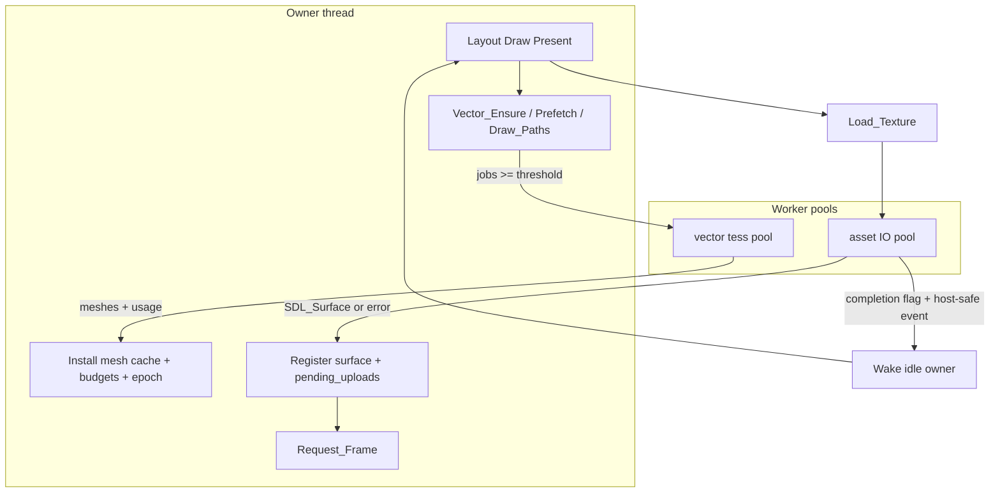

# Parallel tessellation + async asset I/O

## Review status and scope

Implementation closed against the revised contracts: Ready only after upload submit, explicit `Retry_Texture`, generation-checked handles, exclusive tess quotas, best-effort `Draw_Vector_Paths`, pool join/recreate on migrate (no live thread transfer), bounded asset drain/queues, idle wake via completions + USER event, VECTOR.md / AGENTS.md / api.odin updated. Remaining SVG-vector plan items (strokes, importer, widgets) are out of scope for this document.

## Locked decisions (no dual/legacy APIs)

1. **Tessellation** — Mirror glyph raster ([`../font.odin`](../font.odin)): persistent worker pool; **sync burst** (parallel `Tessellate_Into` → join → **owner** installs cache / budgets / `geometry_epoch`). Public **batch ensure / prefetch / multi-draw** collect misses then fan out. Single `Draw_Vector_Path` miss stays serial (same as font threshold). No cross-frame async tess queue (avoids eviction/epoch races); Prefetch is sync like `Font_Prefetch_*`.
2. **Asset I/O** — `Load_Texture` becomes **non-blocking**: returns a handle immediately in `Pending` / `Ready` / `Failed`; disk+decode on workers; **owner** registers surface and queues deferred GPU upload; **`Request_Frame`** on state change. Call sites and Image docs updated; no sync-only duplicate API.

## Architecture



Owner-only (never from workers): `state.vector.paths` / `path_cache_bytes` / `geometry_epoch` / `vector_frame()` recording / eviction; `state.assets.paths` / `state.textures` records / `pending_uploads` / atlas shelves.

All public APIs in this plan run on the owner thread; reject calls from worker threads and reentrant calls during an active tessellation burst. The owner does not process updates, destroys, unloads or callbacks while joining a tessellation burst. Workers receive immutable inputs and return owned results through synchronized queues/slots. Worker completion publication uses release/acquire synchronization; counters alone are not a memory-publication mechanism. Asset workers may overlap tessellation workers, but neither pool may call application procedures or mutate owner state.

---

## Part A — Vector tessellation workers

### A1. Pool (copy font Group G shape)

New state on [`Vector_State`](../vector_scene.odin) (or adjacent in [`vector_path.odin`](../vector_path.odin)):

- `VECTOR_TESS_MAX_WORKERS :: 4`, `VECTOR_TESS_PARALLEL_THRESHOLD :: 4` (match font constants style)
- Pool slots: thread, work/done semaphores, per-slot scratch arena (heap, not `temp_allocator`), job chunk pointer. Initialize each thread's Odin context explicitly with worker-private scratch and a thread-safe result allocator; never share an unsynchronized owner tracking allocator. Retained results must survive scratch reset and transfer cleanup responsibility to the owner exactly once.
- `vector_tess_pool_ensure` / `vector_tess_pool_shutdown` (quit, post, join, destroy, free scratch) called from vector init/shutdown paths already used by `vector_paths_shutdown`
- `vector_tess_workers` counter + `vector_owner_assert_no_tess_workers` before cache eviction, path destroy, and cache install (same discipline as `atlas_owner_assert_no_raster_workers`)

### A2. Job + serial/parallel runners

Job input (immutable for workers):

- Owner-created immutable commands snapshot, or a pinned immutable path revision; identify handle index, generation and path revision. Never copy from mutable owner records on a worker. Retain the snapshot until all jobs join, including failures.
- Effective physical linear transform `[4]f64`, fill/clip rule, operation type and complete geometry-affecting settings. Use the cache-key contract in [`SVG-VECTOR-IMPLEMENTATION-PLAN.md`](SVG-VECTOR-IMPLEMENTATION-PLAN.md), including stroke settings and approximation policy where supported; unsupported operations fail explicitly.
- An exclusive `Limits` quota reserved by the owner before dispatch (see A3), not a shared mutable slice of the remaining frame budget.

Worker output:

- `v.Mesh` (heap via `context.allocator` or explicit mesh allocator passed in job—same as today’s cache mesh ownership)
- `Build_Usage` for all bounded work, including failed builds: segments, triangles, intersections, edge tests, exact-arithmetic work and peak/result bytes
- success / `Vector_Error`

Procs:

- `vector_tessellate_jobs_serial`
- `vector_tessellate_jobs` — if `len < THRESHOLD` or pool fail → serial; else split across workers, begin/end worker count, wait done
- Workers call only `oni_vector.Tessellate_Into` + private scratch; **no** `state.vector` mutation

Handle partial pool initialization transactionally. If thread/semaphore creation fails, stop and join all started slots before freeing their state. Serial fallback is allowed only for jobs not already executed; never rerun a failed geometry build merely because parallel execution failed. A failed job must publish a result and signal completion through a guaranteed cleanup path so the owner cannot hang waiting for an ordinary reported error.

### A3. Owner commit

Before dispatch, resolve and deduplicate cache keys in first-input order, pin cache hits needed by this batch, and reserve bounded job/snapshot/result memory. Admit jobs in that same order using deterministic exclusive work quotas whose sum fits the remaining frame budget. Freeze the exact quota-allocation algorithm and low-budget outcomes in tests before implementation, and use it unchanged in the serial batch runner; do not give every worker the entire remaining budget. Reject jobs that cannot be admitted without starting them. Commit admitted results in input order, independent of completion order, so diagnostic ordering, geometry IDs and eviction are reproducible.

`vector_path_install_tess_results(jobs)` on owner after join:

- Settle reserved work against actual `Build_Usage` for successful and failed builds; release unused reservations only after join. Failure never refunds work already performed. Check aggregate limits before starting work, not only at cache installation.
- Evict under `VECTOR_CPU_CACHE_BUDGET` before retaining meshes
- Write `Vector_Path_Cache` slot, bump `next_geometry_id` + `geometry_epoch` once per new mesh
- Free failed/unused worker meshes

Before each install, revalidate generation, path revision and the complete cache key. Drop stale results with a diagnostic and free their meshes. Cache eviction must respect recorded/in-flight and current-batch pins; insufficient space is a reported per-job failure, never eviction of a mesh still needed by the batch. Bound transient results separately from the retained CPU cache, since parallel jobs can finish before eviction or installation is possible.

`Draw_Vector_Path` miss path: call serial single-job helper (unchanged external behavior).

### A4. Public batch APIs (PascalCase in [`api.odin`](../api.odin))

| API | Behavior |
|-----|----------|
| `Vector_Prefetch_Paths(specs: []Vector_Path_Tess_Spec)` | Synchronous owner call; resolve/deduplicate misses, build and install; return per-input results plus the first error in input order |
| `Vector_Ensure_Path_Meshes` | Exact alias of `Vector_Prefetch_Paths`, including results, failure and budget semantics; no separate implementation |
| `Draw_Vector_Paths(items: []Vector_Path_Draw)` | Ensure unique misses, then record successful items in original draw order; return per-input results and the first error. A failed item records nothing; later valid items still draw |

`Vector_Path_Tess_Spec` contains only geometry-affecting inputs: handle/revision, transform, rule and supported stroke/operation settings. Opacity belongs on draw items, not tessellation specs. Transform keying must match Draw (DPI × artboard zoom on linear part)—specs use the **same key function** as `Draw_Vector_Path`. Empty batches succeed without starting workers; duplicate inputs share one build and report the same build outcome. The parallel threshold counts unique admitted misses, not input items or cache hits. Results distinguish cache hit, built, invalid handle, geometry error and limit/allocation failure. Each item is atomic; the batch is intentionally best-effort rather than all-or-nothing.

Prefetch/Ensure may run only within an initialized owner resource/frame scope with explicit budgets; reject calls outside that scope. Draw APIs run only during Draw. Prefetch during Layout must not record draw commands or alter the tree. The synchronous return guarantees meshes have been installed or errors returned; it does not guarantee permanent residency after pins are released. Drawing after eviction rebuilds through the same bounded path.

Update [`templates/vector_gallery.odin`](../templates/vector_gallery.odin) cold path to prefetch or `Draw_Vector_Paths` where many unique meshes appear.

### A5. Lifecycle / hot reload

- Shutdown order: join tess pool **before** clearing path caches / destroying meshes
- Before unloading an app/engine DLL, stop dispatch, join and destroy every worker whose entry point, allocator callback or state belongs to that DLL. This pre-unload barrier applies even to idle persistent threads; migrating state after unload is too late. Preserve retained CPU path/cache data deliberately, migrate only data fields, and recreate pool synchronization objects and function pointers after bind. Never copy live thread, mutex or semaphore handles into a second owner.
- No tess workers during `vector_path_evict_cache` / `Vector_Destroy_Path`

### A6. Tests (write first — TDD)

In [`vector_path_test.odin`](../vector_path_test.odin) / new `vector_tess_pool_test.odin`:

- Parallel vs serial identical meshes for N unique paths (threshold boundary 3 vs 4)
- Frame budget accounting with parallel failures
- Cache byte accounting / eviction with workers joined
- Owner mutation and reentrant/wrong-thread API calls are rejected while a burst is active; updates after join invalidate normally. Inject stale revisions to verify result rejection and cleanup.
- Unique-miss threshold with duplicates/cache hits; empty batch; per-item failure ordering; draw order; fully pinned cache exhaustion; deterministic serial/parallel quota equivalence
- Partial pool initialization, snapshot/result allocation failures and worker error completion without deadlock
- Shutdown with pool started; leak tracking via `test_all.sh`
- GPU: existing path GPU tests plus mandatory Prefetch/Draw_Paths stress pass, including eviction and recorded-resource lifetime
- Re-run [`scripts/benchmark_vector.sh`](../scripts/benchmark_vector.sh)—gate must not regress. Measure cache hits and misses rather than assuming morph animation is cache-hit; continuously changing paths can require fresh geometry each frame.

Docs: [`VECTOR.md`](../docs/VECTOR.md) — pool, Prefetch/Draw_Paths, owner rules.

---

## Part B — Async texture asset I/O

### B1. Status model (replaces sync-only success)

In [`types.odin`](../types.odin) / assets:

```odin
Texture_Load_Status :: enum { Pending, Ready, Failed }
```

- `Texture_Handle` remains generation-checked; add `Texture_Status(handle) -> Texture_Load_Status` and `Texture_Error(handle)` returning a caller-owned diagnostic copy with documented cleanup. Invalid/stale handles report Failed plus an invalid-handle diagnostic, without touching a reused slot. Public dimensions are zero until Ready.
- `Load_Texture(path) -> (Texture_Handle, bool)` — `bool` means **accepted** into the resource table (cached Ready, existing Pending or existing Failed included). It does not mean pixels are ready. Invalid paths, admission limits or placeholder allocation failure return an invalid handle and false, with a structured diagnostic; they leave no half-created map entry.
- A failed record and its diagnostic remain stable until explicit retry or final release. Repeated `Load_Texture` never retries implicitly. `Retry_Texture(handle) -> bool` is owner-only, accepts only a valid Failed record, increments its request token and transitions to Pending if admission succeeds. A rejected retry preserves Failed and its diagnostic. This explicit retry contract replaces the earlier automatic-on-Load proposal and prevents frame-by-frame callers from creating an uncontrolled retry loop. This is not a second synchronous loading API.

Use the state machine `Pending(decode) → Pending(upload) → Ready`, with either pending phase able to transition to Failed. Ready means a valid GPU texture exists and upload commands are ordered before any sampling in the consuming submission; decode completion or merely adding to `pending_uploads` is insufficient. Allocation, upload encoding and submission failure must not publish Ready prematurely. Once its upload dependency is safely submitted, ordinary ordered GPU execution does not require an extra CPU fence wait before drawing. Report source/decode/GPU failure categories separately. A state transition triggers an owner frame request so layout can remeasure when dimensions become available.

### B2. Asset IO pool

New in [`assets.odin`](../assets.odin) (or `assets_io.odin`):

- Pool (1–4 workers): immutable owned request → disk read/decode on worker → post result `{handle index/generation, request token, device generation, owned surface or nil, owned diagnostic}`. Capture thread-local decoder errors before another operation overwrites them. Audit selected decoder backends for concurrent use and initialization requirements; serialize only a backend requiring it, without moving decode to the owner.
- Completion queue drained **only on owner** at fixed points: `run_frame` start (after `frame_wait_if_idle` / when frame runs), and `assets_io_drain` before `texture_uploads_flush` / present
- Owner adopts successful surfaces into the existing Pending record and queues deferred upload, preserving the original handle; do not create a second texture ID when registering the surface. Validate handle generation and request token before adoption; stale completions destroy their surface and diagnostic without changing a record.
- On failure: destroy nothing leaked; mark Failed; `Request_Frame`
- On decode success: retain internal decoded dimensions, queue deferred upload and remain Pending until the readiness contract is met. Queueing an upload also requests a frame; publish dimensions with Ready.

Placeholder record creation must not break `TEXTURE_WHITE_ID` / atlas ids—use normal `texture_register` empty pending slot or dedicated pending list until surface exists. **Chosen:** create `Texture_Record` with `surface=nil`, `gpu=nil`, `status=Pending` at enqueue; register path→id immediately so duplicate `Load_Texture` returns same handle.

Normalize path keys lexically on the owner relative to the fixed consumer asset root; do not perform existence checks, canonicalization requiring filesystem access or header reads there. Capture an absolute request path so later working-directory changes cannot retarget jobs. Coalesce equal normalized keys before dispatch; document that symlink aliases remain distinct. Each successful `Load_Texture` acquires one reference to the shared handle, including cache hits; each matching unload releases one. Final release removes the path mapping, invalidates the generation/token and cancels or drops outstanding work. A later load creates a new generation. Workers hold owned request data, not a live pointer into the path map.

Reserve completion capacity and decoded-byte credit before starting a job. A full completion queue must never trap a worker that shutdown is trying to join. The owner drains a bounded number of completions and upload bytes per frame, then requests another frame while work remains. Keep status Pending until the request's actual upload turn; draining must not turn one frame into an unbounded decode/upload burst.

### B3. Owner / present / reload

- Extend Group G: asset workers never mutate records. Before teardown or DLL unload, close admission, invalidate outstanding request tokens, signal stop, join workers without holding queue locks, then drain/drop completions and free queue/request storage. Check stop between bounded work stages; an active decoder call completes before join returns. Never unload code that a worker can still execute.
- Cancel queued work and complete-and-drop active surfaces on shutdown (DestroySurface if not adopted). Each surface, request path, error string and byte reservation has exactly one cleanup owner, including cancellation and stale completion paths.
- On-demand: worker publication must wake the owner **before** owner-side drain can run. Use a synchronized completion flag plus a thread-safe host-owned event/wake primitive valid across reload; workers must not call owner-only `Request_Frame` or dereference replaceable engine state. The idle wait checks/drains the completion flag and event without a lost-wakeup window. Once awake, the owner drains and requests frames for Ready/Failed transitions and remaining upload work. Event-push failure uses a defined bounded wait/poll fallback; it cannot strand a Pending handle indefinitely.
- [`present.odin`](../present.odin): drain completions before flush so same frame can upload

For GPU recreation, stop/join old workers before replacing device-dependent state, increment the device generation and retain/requeue logical requests deliberately. CPU surfaces may be reused only after the owner validates that they are device-independent and still match a live request; upload commands and GPU handles from the old device are discarded. Existing retained assets return to Pending until their replacement GPU upload is valid. If the device is unavailable, report renderer failure rather than claiming Ready. Ordinary hot reload preserves logical asset references but rebinds functions and recreates pools before accepting new work.

If asset replacement/reload is supported, build its replacement separately: failed replacement preserves the previous valid Ready revision and reports a reload diagnostic; successful replacement swaps atomically and retires the old GPU resource only after recorded/in-flight users release it. Final unload likewise defers GPU destruction until safe retirement. `Retry_Texture` handles Failed initial loads and does not implicitly replace an existing Ready asset.

### B4. Call-site updates (no legacy)

- [`app/docs/routes.odin`](../../app/docs/routes.odin) / template docs: load once into Persistent; draw only when `Texture_Status == .Ready` (or Image widget skips empty)
- [`widgets`](../widgets) Image: if handle Pending/Failed, draw nothing or theme placeholder—**must not** sample missing GPU texture
- Docs strings that say Load_Texture returns ready texture → update

The Image widget must not busy-retry Failed loads, retain a raw surface pointer or assume dimensions are final in Layout. Its controlled config supplies the handle; the app owns its acquire/release lifetime and explicit retry. Specify zero-intrinsic-size/placeholder sizing while Pending and request layout on Ready. Layout and Draw use one owner-published texture revision per frame; completion draining before present must not change an already measured widget's intrinsic dimensions mid-frame. Newly completed records can become visible in the next UI frame.

### B5. Tests first

Extend [`assets_test.odin`](../assets_test.odin):

- New accepted load returns Pending; decode drain alone remains Pending, and successful upload submission permits Ready at the next UI publication boundary. Duplicate paths share a handle with balanced references.
- Missing file → Failed; Request_Frame side effect testable via `frame_dirty`
- Shutdown mid-Pending (no leak / no join hang)
- `gpu_reload` / `texture_release_gpu` with in-flight load
- Ready path still works for BMP/PNG/JPEG fixtures
- Parallel many loads; path cache string ownership (clone once)
- Idle owner with no input: completion alone wakes, drains, uploads and paints; completion racing idle entry cannot be lost
- Decode success followed by GPU allocation/upload/submission failure never exposes Ready or samples a missing texture
- Release/retry/reload followed by old completion; slot reuse; duplicate references unloaded in different orders
- Stable Failed status under repeated Load calls; explicit retry coalescing/rejection; structured error lifetime
- Queue/byte-credit exhaustion, oversized or malformed images, bounded drain work and shutdown with a full completion queue
- Repeated DLL hot reload with idle and active workers, old-device uploads, wake failures and pre-unload joining
- Layout/Draw revision consistency when completion arrives between passes or before present

---

## Shared production bar

### Admission and memory limits

The following are initial configurable defaults, enforced before dispatch/allocation and reported in diagnostics. The final benchmark must pass with these defaults; increasing them requires a documented plan change and repeated memory/performance acceptance.

| Resource | Default bound |
|---|---:|
| Tessellation workers / asset workers | 4 / 4 |
| Unique tessellation jobs per burst | 4,096 |
| Tessellation snapshots, scratch and uninstalled results combined | 128 MiB |
| Queued and active asset requests combined | 256 |
| Completion slots reserved before dispatch | One per active worker |
| Encoded source bytes per image | 32 MiB |
| Image width or height / decoded bytes per image | 8,192 pixels / 64 MiB |
| All decoded surfaces and decoder scratch in flight | 128 MiB |
| Owner completions drained per frame | 16 |
| Asset upload bytes per frame | 16 MiB |

Tessellation also inherits every geometry/frame/cache limit in the SVG/vector plan; its burst memory cap is additional to the retained cache cap. Asset limits include work waiting for owner adoption and surfaces waiting for upload, not just active decoders. Bound header parsing and validate image dimensions/decoded size before large allocation; use a decoder with enforceable scratch limits or reject formats for which those bounds cannot be guaranteed. Worker-private allocator overhead and temporary copies count against the appropriate reservation. Uploads larger than the per-frame allowance must be chunked safely across frames without exposing Ready early; otherwise reject admission with a diagnostic rather than leaving an unserviceable Pending job. A worker may not hold decoder memory while indefinitely waiting for completion capacity.

### Verification and evidence

- **TDD:** tests for A6/B5 authored and reviewed before implementation
- **Memory:** worker scratch arenas freed on pool shutdown; command copies deleted; surfaces owned until register or DestroySurface on fail; no `temp_allocator` across frames for retained results
- **Defense:** generation checks on handles; reject draw of Failed/Pending textures; tess workers never touch GPU
- **Concurrency:** deterministic barrier-driven race tests rather than sleep-based timing; run an available thread-race checker where compatible, otherwise document the tooling limit and retain explicit synchronization/lifetime tests. ASAN and leak tracking alone do not establish race freedom.
- **No Tengu coupling;** no SVG parser in this feature (still M6)
- **Verify:** `./oni/scripts/test_all.sh` (colors tengu oni widgets) + `--asan` on touched packages; real-GPU vector/asset readiness tests; `benchmark_vector.sh` full gate. Missing GPU access blocks acceptance; skipped tests are not passes. Record warm-cache and cold unique-miss results separately, including owner p95, join time, pool startup, peak memory and overlap of both pools. Require the SVG/vector plan's release thresholds, no more than 5% warmed ordinary-UI CPU regression, and no worker leaks over 100 lifecycle/reload cycles. Compare cold serial/parallel runs using identical keys, quotas and hardware; report results without assuming a speedup.
- **Docs:** VECTOR.md + short note in ARCHITECTURE or assets section; AGENTS.md only if public Load_Texture contract changes enough to mention

## Implementation order

1. Freeze owner/reentrancy, batch-result, budget, texture readiness/retry and wake contracts; add deterministic tests before each implementation slice. Before executing this plan, obtain the fresh adversarial subagent review required by the common AGENTS.md; that review reads the plan without conversation context and edits no files.
2. Tests for tess pool + Prefetch/Draw_Paths contracts
3. Tess pool + install + Prefetch/Ensure + Draw_Paths; wire pre-unload shutdown; gallery touch
4. Tests for async Load_Texture status machine, idle wake, stale completions and GPU failures
5. Asset pool + bounded drain points + Image/docs call sites
6. Hot-reload/shutdown stress + full test/bench gate
7. Docs and recorded acceptance evidence

## Exit criteria (no gaps)

You can confidently say the feature is complete when:

- With an available pool, tessellation of ≥4 unique admitted cache misses via Prefetch or `Draw_Vector_Paths` uses workers; results and per-input outcomes match the serial runner under identical quotas. Pool-unavailable fallback is tested separately and cannot stand in for evidence that parallel execution works. Budgets/cache/epoch/shutdown/hot-reload are correct under leak checks.
- Single `Draw_Vector_Path` miss behavior preserved
- `Load_Texture` never blocks the owner on disk/decode; decode success remains Pending until GPU-ready ordering is guaranteed; failure remains stable until explicit retry. Idle completion wake, bounded queues/drains, stale-result rejection, reference ownership and pre-unload joins pass deterministic tests.
- Widgets never bind unready textures; all listed tests and benchmark gate pass
- No leftover sync-only asset API, feature flags, or “temporary” serial shims beyond the intentional threshold serial fallback (same as font)
